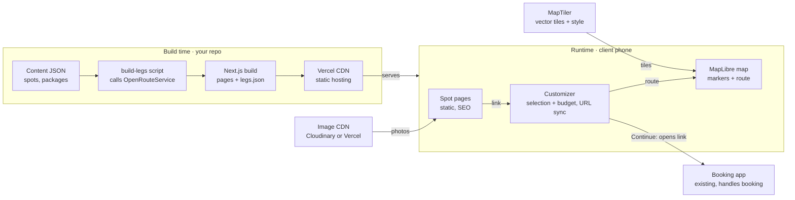

# Paris Photowalk Customizer — Macro Spec

Oct 16, 2026

## Overview

A mobile-first web app where a client picks a photowalk package, chooses shooting spots around the Eiffel Tower area, and instantly sees whether the route fits the package time, with sample photos for every spot.

- **Goal:** turn "which package should I book?" into a visual, self-serve decision, and showcase the portfolio spot by spot.
- **Users:** prospective clients, mostly tourists browsing on a phone, often on roaming data. Secondary: the photographer, who manages packages and spots.
- **In scope (v1):** package (duration) selection, start-spot choice, spot map, spot selection with time budget, walking route and times, photo previews, shareable selection link, FR/EN. Packages and spots are hardcoded.
- **Phase 2:** an admin page where the photographer edits packages and adds spots, with file-based data storage, plus pre-filling the booking app with the client's selection.
- **Out of scope:** booking, payment, calendar and availability. These are handled by an existing app; this app only opens it, with a ready-written summary the client can copy and paste.

## User flow

One screen, six steps, no account needed.

1. **Land on the map.** The map is tilted over the Eiffel Tower area, all spots are pinned, and a package picker sits in the bottom sheet.
2. **Pick a package**, which is simply a duration (for example 1h, 2h, 3h). The time budget bar appears.
3. **Pick a starting spot.** The client taps the spot where they want the photowalk to begin, and it is marked as the start.
4. **Add more spots.** Tapping a spot opens its photo sheet, where it can be added or removed. The budget bar updates live: shooting time + walking time vs. package time. Spots that no longer fit are greyed out.
5. **See the route.** The walking path is drawn from the start spot through the selected spots in the suggested order, with minutes per leg and the total.
6. **Hand off.** The "Continue" button opens the existing booking app. A "Copy summary" button copies a ready-written message (package, start spot, spots in order, total time) to paste into the booking app or a chat. A shareable link to the summary is also offered.

## Functional requirements

| Area | Requirement |
| --- | --- |
| Packages | A package is only a duration in minutes (for example 60, 120, 180), shown as a label like "2h". No default spots or other rules. Hardcoded in v1. |
| Start spot | The client picks one starting spot before adding others. Any spot can be the start. It always stays first in the route; changing it re-orders the rest. |
| Spots | Each spot has coordinates, a title, a short description, 3–8 sample photos, and a shooting time in minutes. Shooting time is fixed per spot by the photographer and is not editable by the client. |
| Time budget | Total = sum of shooting time + sum of walking legs. The bar is green under 90% of the package, amber from 90 to 100%, and red over 100%. Over budget is allowed visually, but the hand-off button is disabled. |
| Ordering | The start spot is fixed first. The remaining spots are ordered to minimize walking from it, using brute force on the precomputed matrix (fine under ~10 spots). The client can drag to reorder everything except the start. |
| Route | The real walking path is drawn on the map from precomputed GeoJSON, with minutes shown per leg and as a total. |
| Photo sheet | A swipeable carousel with full-screen view, plus spot info and a button: "Start here" if no start is chosen yet, otherwise Add/Remove. |
| Suggestions | When a package is picked, the spots that would not fit are greyed out, given the current selection. |
| Share | The selection is encoded in the URL (`?pkg=120&start=trocadero&spots=bir-hakeim,champ-de-mars`), so a reload or shared link restores it. |
| Hand-off | "Continue" opens the booking app's link in a new tab; no data is passed in v1. "Copy summary" copies a ready-written message in the client's language, for example: "Hi! I'd like the 2h photowalk starting at Trocadéro, then Bir-Hakeim and Champ de Mars (1h52 total)." |
| Languages | French and English, with English as the default for tourists, plus a toggle. |
| Admin (phase 2) | A password-protected /admin page to edit package durations and add or edit spots (photos, coordinates, shooting time). Data moves to file storage, for example JSON in Vercel Blob or S3. Saving a new spot computes its walking legs. In v1, everything is hardcoded in the repo. |
| Booking pre-fill (phase 2) | "Continue" opens the booking app with the package, start spot and spots already filled in, using whatever the booking app accepts (URL parameters or a form). |

## UX & design

The map is the stage and her photos are the content, so the UI stays quiet and lets both breathe.

- **Mobile layout:** a full-screen map with a draggable bottom sheet that has three snap points: peek (package picker + budget bar), half (spot list), and full (photo carousel).
- **Desktop layout:** the same components, with the sheet becoming a fixed 400 px left sidebar and the map filling the rest.
- **Map style:** a custom MapLibre style in her brand palette, for example warm cream ground, muted Seine blue, soft gold accents, labels reduced to landmarks. The camera is pitched at about 50° with 3D building extrusions. The option of a single low-poly Eiffel Tower model can come later.
- **Spot markers:** circular photo thumbnails rather than generic pins. A selected spot gets a gold ring and its order number, and the start spot gets a flag badge.
- **Budget bar:** always visible in the sheet's peek state, so clients never lose sight of the constraint.
- **Motion:** when a spot is tapped, the camera flies to it and the route animates as it draws. Keep motion short (under 600 ms) and respect reduced-motion settings.
- **Typography:** one elegant serif for titles and a clean sans for UI.

## Data model

All content lives as typed JSON in the repo under `/content`. In v1 there is no database: content is hardcoded, and editing a spot is a commit that triggers a redeploy. Phase 2 moves the same JSON to file storage, edited from the admin page.

```ts
type LocalizedText = { en: string; fr: string };

type Spot = {
  id: string;                 // "trocadero"
  name: LocalizedText;
  description: LocalizedText;
  coords: [lng: number, lat: number];
  shootMinutes: number;       // fixed per spot, set by the photographer
  photos: { src: string; alt: LocalizedText; w: number; h: number }[];
};

// A package is just a duration; the label ("2h") is derived
type Package = {
  id: string;                 // "120"
  minutes: number;            // time budget
};

// Precomputed, generated by script
type Leg = {
  from: string; to: string;   // Spot ids
  walkMinutes: number;
  meters: number;
  geometry: GeoJSON.LineString;
};

// Client state (Zustand), mirrored in the URL
type Selection = {
  packageId: string | null;
  startSpotId: string | null; // chosen by the client, always first
  spotIds: string[];          // other spots, in route order
};
```

Files: `content/spots.json`, `content/packages.json`, and the generated `content/legs.json`.

## Architecture & tech stack

In v1, a static Next.js site with one client-side customizer, no backend, and no database. Phase 2 adds the admin page, a small API route and file storage. Everything heavy is done at build time.



Content and precomputed routes are baked into the build. At runtime, the phone only fetches pages, photos, and map tiles, then opens the booking app, with the summary ready to paste.

| Layer | Choice | Why |
| --- | --- | --- |
| Framework | Next.js (App Router) + TypeScript | File routing, static SEO pages, built-in image optimization |
| Map | MapLibre GL JS via `react-map-gl/maplibre`, loaded client-only with `dynamic(..., { ssr: false })` | Open source, fully styleable, 3D extrusions and custom 3D layers |
| Tiles & style | MapTiler (free tier) + custom style | Brand-colored basemap without Google Maps pricing |
| Styling | Tailwind CSS | Fast iteration, small CSS |
| UI pieces | shadcn/ui, Vaul (bottom sheet), Embla (carousel) | Proven mobile primitives, no heavy UI kit |
| State | Zustand + `nuqs` for URL sync | Tiny store; selection shareable by link |
| Content | JSON in repo, validated with Zod at build | No CMS to run; typed and safe |
| Routing data | OpenRouteService, build time only | Free tier; no runtime API calls |
| Images | `next/image` (or Cloudinary if her library grows) | AVIF/WebP, responsive sizes, blur placeholders |
| i18n | `next-intl` | FR/EN routes with `[locale]` |
| Hosting | Vercel | Zero-config for Next.js. The free Hobby tier is for non-commercial use, so a business site belongs on Pro or on Netlify/Cloudflare |

Folder layout:

```text
app/
  [locale]/page.tsx              # customizer
  [locale]/spots/[id]/page.tsx   # static SEO page per spot
components/
  map/  sheet/  budget/  carousel/
content/
  spots.json  packages.json  legs.json  legs.overrides.json
lib/
  budget.ts  order.ts  url-state.ts
scripts/
  build-legs.ts
```

## Walk-time precompute pipeline

Spots are fixed, so walking times are computed once at build time, never in the client. The cost is zero at runtime, and it works offline.

1. `scripts/build-legs.ts` reads `spots.json`.
2. For every ordered pair of spots (both directions, so overrides can differ per direction), it calls the OpenRouteService `foot-walking` directions API (free tier). With 15 spots, that's 210 calls, well within limits.
3. It writes `legs.json` with minutes, meters, and simplified route geometry (`@turf/simplify`, Douglas-Peucker, about 5 m tolerance, coordinates rounded to 5 decimals, to keep the file small).
4. It runs manually with `pnpm build-legs`. A hash of `spots.json` is stored alongside the output, and the script skips the API calls when the hash is unchanged. `--force` ignores the hash and recomputes everything. It is not a `next build` step in v1, so deploys never depend on a third-party API.
5. The photographer can override a leg's minutes by hand in `legs.overrides.json`. This covers real-world quirks such as stairs at Trocadéro, crowds, or a closed bridge.

Decisions:

- **Walking minutes:** the ORS duration, rounded up to whole minutes (`Math.ceil(seconds / 60)`), with no pace factor. Pace corrections are done through overrides after walking the route once.
- **Overrides:** keyed by directed pair, `{ "trocadero>bir-hakeim": { "walkMinutes": 14 } }`. Only `walkMinutes` can be overridden; geometry and meters always come from ORS. An override that names an unknown spot id makes the script fail.
- **Failure behaviour:** everything is computed in memory and `legs.json` is written only after all pairs succeed, so a half-written file can never be committed. Retry on 429 and 5xx up to 3 times with backoff. Any other failure exits non-zero and names the pair.
- **Testability:** the pure logic (pair list, converting and rounding an ORS response into a `Leg`, merging overrides, hash check, `legSchema` validation) lives in `lib/legs.ts` and is tested with Vitest on a recorded ORS fixture. The thin HTTP part is verified by running the script once.

## Non-functional

| Concern | Target |
| --- | --- |
| Performance | Map interactive in under 3 s on a mid-range phone over 4G; initial JS under 250 KB gzipped excluding MapLibre, which is lazy-loaded |
| Images | AVIF/WebP, responsive sizes, blur placeholders; thumbnails under 30 KB; full-size loaded only when the carousel opens |
| SEO | A static page per spot (`/spots/[id]`) with photos, description and Open Graph image, because these pages rank for searches like "photoshoot Trocadéro" |
| Accessibility | Every spot is reachable from the list, not only the map; alt text on photos; 44 px touch targets; reduced-motion respected |
| Analytics | Privacy-friendly (Plausible or Vercel Analytics, no cookie banner): track package picked, spots added, and hand-off clicked |
| Browsers | Last 2 versions of iOS Safari, Chrome Android, and desktop Chrome, Safari, and Firefox |

## Milestones and open questions

With around 6 to 8 spots, a usable version is a few weekends of side-project work.

1. **M1 — Data & map:** scaffold, hardcoded content JSON with 3 real spots, the legs script, and a MapLibre map with markers.
2. **M2 — Customizer core:** package picker, start-spot picker, selection store, budget logic, route drawing, URL sync.
3. **M3 — Photo experience:** bottom sheet, carousel, image pipeline.
4. **M4 — Polish:** custom map style, motion, FR/EN, spot SEO pages, analytics.
5. **M5 — Hand-off:** "Continue" link to the booking app and the copy-summary message, then test with real clients.
6. **Phase 2 — Admin:** `/admin` page with simple auth, package and spot editing, JSON in file storage, walking legs recomputed when a spot is added, and booking app pre-fill.

Open questions:

- [x] **Hand-off:** Continue opens the booking app and the client copies a ready-written summary; pre-fill comes in phase 2.
- [ ] **Content:** final package durations and spot list (to be provided later).
- [x] **Start point:** the client chooses their starting spot.
- [x] **Shooting time:** fixed per spot, not adjustable by the client.
- [x] **Time of day:** not used; no light or hour logic.

## Build plan

Each milestone ends with something deployed and testable on a phone. Tick tasks off as you go.

### M1 — Data & map foundation

**Status (Oct 18, 2026):** scaffold, content and schemas are in place (PR #1). `build-legs` is a stub that throws, and the map component is not started. Both API keys are in `.env`. Not yet confirmed: the Vercel deploy and the MapTiler account and style.

- [x] Create the Next.js app (App Router, TypeScript, Tailwind), with next-intl, nuqs, Zustand, MapLibre and Vitest installed and the folder layout in place.
- [ ] Connect the repo to Vercel and deploy from day one.
- [x] Write types and Zod schemas for Spot, Package and Leg, with a content validation test.
- [x] Create `spots.json` with 3 spots (placeholder photos, to be replaced with real ones) and `packages.json` with 60, 120 and 180 minutes.
- [ ] Write the `build-legs` script (stub exists; ORS key is in `.env`):
  - [ ] Pure logic in `lib/legs.ts` with Vitest tests on a recorded ORS fixture.
  - [ ] ORS calls for every ordered pair, with retry, simplified geometry, overrides merged, output to `legs.json` only if all pairs succeed.
  - [ ] Hash skip on `spots.json` and a `--force` flag.
- [x] MapTiler key is in `.env`.
- [ ] Confirm the MapTiler account. Build the map component with `react-map-gl/maplibre`, loaded client-only.
- [ ] Show plain circle markers, center the camera on the Eiffel Tower area, pitch it to about 50°, and add the 3D buildings layer.

**Done when:** the deployed URL shows the tilted map with 3 spots, and `legs.json` contains every pair.

### M2 — Customizer core

- [ ] Build the Zustand store holding package, start spot and selected spots, with actions to pick a package, set the start, and add or remove spots.
- [ ] Sync the store to the URL with `nuqs` (`pkg`, `start`, `spots`). On load, restore the selection and ignore unknown ids.
- [ ] Write pure functions in `lib/`:
  - `budget`: shooting time + walking time vs. package minutes, plus the green/amber/red status
  - `order`: best walking order from the start spot
  - `fits`: which unselected spots would still fit
- [ ] Unit-test those functions with Vitest. This is where the bugs would hide.
- [ ] Build a simple package picker and budget bar (unstyled for now).
- [ ] Implement the start-spot step: the first tap sets the start and adds a flag on the marker. Changing the start re-orders the route.
- [ ] Draw the route layer by joining leg geometries into one GeoJSON line, with minutes shown per leg.
- [ ] Grey out markers for spots that would not fit.

**Done when:** picking 2h, starting at Trocadéro and adding two spots shows the right route, total time and color, and a page refresh keeps the selection.

### M3 — Photo experience

- [ ] Build the bottom sheet with Vaul, using three snap points (peek, half, full). On desktop, it becomes a sidebar at a breakpoint.
- [ ] Put a spot list in the half state, so every spot is reachable without the map.
- [ ] Build the spot sheet: Embla carousel, full-screen view, description, shooting time, and the Start here / Add / Remove button.
- [ ] Set up the image pipeline:
  - Export photos from her library at about 2000 px on the long edge.
  - Use `next/image` with proper `sizes` and blur placeholders.
  - Turn markers into round photo thumbnails.
- [ ] Add drag-to-reorder in the selected list, with the start spot locked first (dnd-kit).

**Done when:** on a real phone over 4G, tapping a spot shows its photos in about a second, and the sheet feels native.

### M4 — Polish

- [ ] Create the custom map style in the MapTiler editor: brand palette, fewer labels, landmarks kept.
- [ ] Add motion: the camera flies to a tapped spot and the route animates as it draws, with a reduced-motion fallback.
- [ ] Add i18n with `next-intl`: `[locale]` routes, FR/EN text in the content JSON, and a language toggle.
- [ ] Build the spot SEO pages: `generateStaticParams`, metadata, an Open Graph image, and a button that opens the customizer with that spot as the start.
- [ ] Add analytics events: package picked, start set, spot added, summary copied, Continue clicked.
- [ ] Do a performance pass: Lighthouse on mobile, a bundle size check, and confirm MapLibre is lazy-loaded.
- [ ] Do an accessibility pass: touch targets, alt text, and keyboard use on desktop.

**Done when:** the photographer approves the look, and the map is interactive in under 3 s on a mid-range phone.

### M5 — Hand-off & launch

- [ ] Write the summary builder in `lib/summary.ts`: FR/EN templates, readable durations ("1h52"), and spots listed in order.
- [ ] Add the "Copy summary" button: Clipboard API with a fallback, plus a "Copied" toast.
- [ ] Add the "Continue" button: it opens the booking app URL (from config) in a new tab, and is disabled when over budget.
- [ ] Add the share-link button: the native share sheet on mobile, and copy-to-clipboard on desktop.
- [ ] Load all real spots and package durations, re-run `build-legs`, then walk the route once to set any overrides.
- [ ] Connect a custom domain, test with 3–5 real clients, and fix whatever trips them up.

**Done when:** a real client goes from the shared link to the booking app with their summary pasted in.
